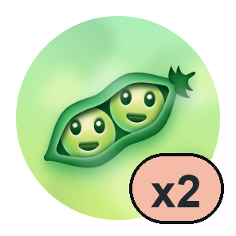
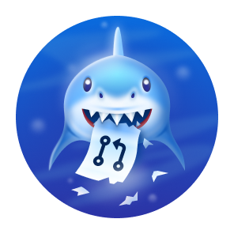
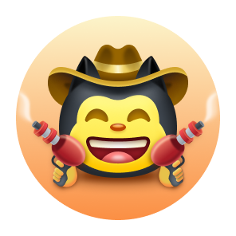

<!-- ================================================================= -->
<!--          BILAL BUTT / DEVELOPER PORTFOLIO                         -->
<!-- ================================================================= -->

<div align="center">

<!-- HERO ANIMATED BANNER -->
<a href="https://github.com/TheBilalButt">
  
</a>

<!-- SECTION DIVIDER -->


<!-- TYPING ANIMATION TERMINAL -->
<a href="https://github.com/TheBilalButt">
  
</a>

<p align="center">
  <a href="https://bilalbutt.tech/"></a>
  <a href="https://github.com/TheBilalButt?tab=repositories"></a>
  <a href="mailto:bilalbutt@duck.com"></a>
</p>

</div>

<br />

<!-- ================================================================= -->
<!--                   SECTION 1: CAPTAIN'S LOG                        -->
<!-- ================================================================= -->

<h2 align="left">Captain's Log<span style="color: #e50914;">.</span></h2>

<table>
  <tr>
    <td width="42%" align="center" valign="middle" style="background-color: #08090d; border: 1px solid #2e1017; border-radius: 8px;">
      
      <br />
      <sub><strong style="color: #ff2244;">BANKAI MODE ACTIVATED</strong></sub>
    </td>
    <td width="58%" valign="top" style="background-color: #08090d; border: 1px solid #2e1017; border-radius: 8px; padding: 16px;">
      <h3 style="color: #ffffff; margin-top: 0;">Identity and Mission</h3>
      <p style="color: #c9d1d9; font-size: 14px; line-height: 1.6;">
        Welcome to my digital headquarters. I am <strong>Bilal Butt</strong>, an <strong>AI and ML Engineer</strong> based in <strong>Pakistan</strong>, specializing in machine learning pipelines, computer vision architectures, and robust software engineering.
      </p>
      <p style="color: #8b949e; font-size: 13.5px; line-height: 1.6;">
        I design and build intelligent systems that convert complex multimodal data into high performance, production ready solutions.
      </p>
      <table style="width: 100%; border: none;">
        <tr>
          <td style="border: none; color: #8b949e; font-size: 13px;"><strong>Name:</strong> Bilal Butt</td>
          <td style="border: none; color: #8b949e; font-size: 13px;"><strong>Location:</strong> Pakistan</td>
        </tr>
        <tr>
          <td style="border: none; color: #8b949e; font-size: 13px;"><strong>Discipline:</strong> Artificial Intelligence</td>
          <td style="border: none; color: #8b949e; font-size: 13px;"><strong>Focus:</strong> Computer Vision and ML</td>
        </tr>
      </table>
      <br />
      <blockquote style="border-left: 3px solid #e50914; color: #ff6b81; margin: 0; padding-left: 10px; font-style: italic; font-size: 12.5px;">
        "We build intelligence to conquer the unknown, solving hard problems through focused engineering."
      </blockquote>
    </td>
  </tr>
</table>

<br />

<div align="center">
  
</div>

<br />

<!-- ================================================================= -->
<!--                   SECTION 2: TECH STACK                           -->
<!-- ================================================================= -->

<h2 align="left">Tech Stack<span style="color: #e50914;">.</span></h2>

<div align="center">

<h3 align="center">Core Programming Languages</h3>
<p align="center">
  <a href="https://skillicons.dev">
    
  </a>
</p>

```
PYTHON / C++ / JAVA / DART / JAVASCRIPT / SQL (POSTGRESQL AND MYSQL)
```

<h3 align="center">Machine Learning and Computer Vision</h3>
<p align="center">
  <a href="https://skillicons.dev">
    
  </a>
</p>

```
PYTORCH / TENSORFLOW / OPENCV / SCIKIT-LEARN / STREAMLIT / HOG / SIFT / GENETIC ALGORITHMS
```

<h3 align="center">Systems, Frameworks and Tools</h3>
<p align="center">
  <a href="https://skillicons.dev">
    
  </a>
</p>

```
FLUTTER / DOCKER / GIT / GITHUB / LINUX / VS CODE / SYSTEM ARCHITECTURE
```

</div>

<br />

<div align="center">
  
</div>

<br />

<!-- ================================================================= -->
<!--                   SECTION 3: ACHIEVEMENTS                         -->
<!-- ================================================================= -->

<h2 align="left">Achievements<span style="color: #e50914;">.</span></h2>

<div align="center">

<p style="color: #c9d1d9; font-size: 14px;">
  Verified GitHub Highlights, Accolades and Recognition
</p>

<!-- HIGHLIGHTS PILL -->
<p align="center">
  <a href="https://github.com/TheBilalButt">
    
  </a>
  <a href="https://github.com/TheBilalButt">
    
  </a>
  <a href="https://github.com/TheBilalButt">
    
  </a>
</p>

<!-- ACHIEVEMENTS GRID -->
<table align="center" style="border: 1px solid #2e1017; background-color: #08090d; border-radius: 10px;">
  <tr align="center">
    <td width="14%" align="center" style="padding: 12px; border: 1px solid #1f2328;">
      <a href="https://github.com/TheBilalButt?tab=achievements">
        
      </a>
      <br /><strong style="color: #ffffff; font-size: 13px;">YOLO</strong>
      <br /><sub style="color: #8b949e;">Merged PR without review</sub>
    </td>
    <td width="14%" align="center" style="padding: 12px; border: 1px solid #1f2328;">
      <a href="https://github.com/TheBilalButt?tab=achievements">
        
      </a>
      <br /><strong style="color: #ffffff; font-size: 13px;">Pair Extraordinaire</strong>
      <br /><sub style="color: #ff99a8; font-weight: bold;">x2 Multiplier</sub>
      <br /><sub style="color: #8b949e;">Co-authored commits</sub>
    </td>
    <td width="14%" align="center" style="padding: 12px; border: 1px solid #1f2328;">
      <a href="https://github.com/TheBilalButt?tab=achievements">
        
      </a>
      <br /><strong style="color: #ffffff; font-size: 13px;">Pull Shark</strong>
      <br /><sub style="color: #8b949e;">Merged pull requests</sub>
    </td>
    <td width="14%" align="center" style="padding: 12px; border: 1px solid #1f2328;">
      <a href="https://github.com/TheBilalButt?tab=achievements">
        
      </a>
      <br /><strong style="color: #ffffff; font-size: 13px;">Quickdraw</strong>
      <br /><sub style="color: #8b949e;">Fast issue response</sub>
    </td>
    <td width="14%" align="center" style="padding: 12px; border: 1px solid #1f2328;">
      <a href="https://github.com/TheBilalButt?tab=achievements">
        
      </a>
      <br /><strong style="color: #ffffff; font-size: 13px;">Starstruck</strong>
      <br /><sub style="color: #8b949e;">Repository recognition</sub>
    </td>
    <td width="14%" align="center" style="padding: 12px; border: 1px solid #1f2328;">
      <a href="https://github.com/TheBilalButt?tab=achievements">
        
      </a>
      <br /><strong style="color: #ffffff; font-size: 13px;">Galaxy Brain</strong>
      <br /><sub style="color: #8b949e;">Accepted answers</sub>
    </td>
    <td width="14%" align="center" style="padding: 12px; border: 1px solid #1f2328;">
      <a href="https://github.com/TheBilalButt?tab=achievements">
        
      </a>
      <br /><strong style="color: #ffffff; font-size: 13px;">Arctic Vault</strong>
      <br /><sub style="color: #8b949e;">Code preserved</sub>
    </td>
  </tr>
</table>

</div>

<br />

<div align="center">
  
</div>

<br />

<!-- ================================================================= -->
<!--                   SECTION 4: BATTLE RECORD                        -->
<!-- ================================================================= -->

<h2 align="left">Battle Record<span style="color: #e50914;">.</span></h2>

<div align="center">
  <table style="border: none;">
    <tr>
      <td width="50%" align="center" style="border: none;">
        
      </td>
      <td width="50%" align="center" style="border: none;">
        
      </td>
    </tr>
  </table>
</div>

<br />

<div align="center">
  <a href="https://github.com/TheBilalButt">
    
  </a>
</div>

<br />

<div align="center">
  <a href="https://github.com/TheBilalButt">
    
  </a>
</div>

<br />

<div align="center">
  
</div>

<br />

<!-- ================================================================= -->
<!--                   SECTION 5: FEATURED PROJECTS                    -->
<!-- ================================================================= -->

<h2 align="left">Featured Projects<span style="color: #e50914;">.</span></h2>

<table>
  <tr>
    <td width="50%" valign="top" style="background-color: #08090d; border: 1px solid #2e1017; border-radius: 8px; padding: 14px;">
      <h3 style="margin-top: 0; color: #ff2a4b;">
        <a href="https://github.com/TheBilalButt/TexEye-AI-FYP" style="color: #ff4d66; text-decoration: none;">TexEye AI: Defect Detection and Quality Management</a>
      </h3>
      <p style="color: #c9d1d9; font-size: 13.5px; line-height: 1.5;">
        AI-powered industrial fabric defect detection and automated quality control framework. BS-AI Final Year Project featuring system analysis, defect classification pipelines, and UML specifications.
      </p>
      <p style="font-size: 12px; color: #8b949e;">
        <strong>Technologies:</strong> <code>Computer Vision</code> <code>AI Inspection</code> <code>System Architecture</code> <code>Mermaid</code>
      </p>
      <a href="https://github.com/TheBilalButt/TexEye-AI-FYP">
        
      </a>
    </td>
    <td width="50%" valign="top" style="background-color: #08090d; border: 1px solid #2e1017; border-radius: 8px; padding: 14px;">
      <h3 style="margin-top: 0; color: #ff2a4b;">
        <a href="https://github.com/TheBilalButt/psychological-state-analysis-multimodal-ai" style="color: #ff4d66; text-decoration: none;">Multimodal AI: Psychological State Analysis</a>
      </h3>
      <p style="color: #c9d1d9; font-size: 13.5px; line-height: 1.5;">
        Multimodal AI research application evaluating psychological markers across vision, voice, and linguistic streams. Features a research dashboard live on Streamlit.
      </p>
      <p style="font-size: 12px; color: #8b949e;">
        <strong>Technologies:</strong> <code>Python</code> <code>Multimodal AI</code> <code>Streamlit</code> <code>Facial Analytics</code>
      </p>
      <a href="https://github.com/TheBilalButt/psychological-state-analysis-multimodal-ai">
        
      </a>
    </td>
  </tr>
  <tr>
    <td width="50%" valign="top" style="background-color: #08090d; border: 1px solid #2e1017; border-radius: 8px; padding: 14px;">
      <h3 style="margin-top: 0; color: #ff2a4b;">
        <a href="https://github.com/TheBilalButt/AMOPS" style="color: #ff4d66; text-decoration: none;">AMOPS: Defense Operations and Fleet Management</a>
      </h3>
      <p style="color: #c9d1d9; font-size: 13.5px; line-height: 1.5;">
        Cross-platform defense operations suite and fleet coordination system built in Flutter. Provides mission asset tracking, multi-unit telemetry, and operational logistics.
      </p>
      <p style="font-size: 12px; color: #8b949e;">
        <strong>Technologies:</strong> <code>Flutter</code> <code>Dart</code> <code>Fleet Telemetry</code> <code>Cross-Platform</code>
      </p>
      <a href="https://github.com/TheBilalButt/AMOPS">
        
      </a>
    </td>
    <td width="50%" valign="top" style="background-color: #08090d; border: 1px solid #2e1017; border-radius: 8px; padding: 14px;">
      <h3 style="margin-top: 0; color: #ff2a4b;">
        <a href="https://github.com/TheBilalButt/realtime-cv-filter-studio" style="color: #ff4d66; text-decoration: none;">Real-time Computer Vision Filter Studio</a>
      </h3>
      <p style="color: #c9d1d9; font-size: 13.5px; line-height: 1.5;">
        Interactive Computer Vision development laboratory for real-time video stream filtering, spatial convolution analysis, and edge detection operators.
      </p>
      <p style="font-size: 12px; color: #8b949e;">
        <strong>Technologies:</strong> <code>Python</code> <code>OpenCV</code> <code>Spatial Filtering</code> <code>Real-Time CV</code>
      </p>
      <a href="https://github.com/TheBilalButt/realtime-cv-filter-studio">
        
      </a>
    </td>
  </tr>
  <tr>
    <td width="50%" valign="top" style="background-color: #08090d; border: 1px solid #2e1017; border-radius: 8px; padding: 14px;">
      <h3 style="margin-top: 0; color: #ff2a4b;">
        <a href="https://github.com/TheBilalButt/zombie-outbreak-simulator" style="color: #ff4d66; text-decoration: none;">Zombie Outbreak Simulator (Agent-Based Model)</a>
      </h3>
      <p style="color: #c9d1d9; font-size: 13.5px; line-height: 1.5;">
        Real-time interactive Agent-Based Modeling web platform simulating epidemiological transmission dynamics and spatial contagion thresholds.
      </p>
      <p style="font-size: 12px; color: #8b949e;">
        <strong>Technologies:</strong> <code>JavaScript</code> <code>Agent-Based Modeling</code> <code>Spatial Dynamics</code> <code>HTML5</code>
      </p>
      <a href="https://github.com/TheBilalButt/zombie-outbreak-simulator">
        
      </a>
    </td>
    <td width="50%" valign="top" style="background-color: #08090d; border: 1px solid #2e1017; border-radius: 8px; padding: 14px;">
      <h3 style="margin-top: 0; color: #ff2a4b;">
        <a href="https://github.com/TheBilalButt/Computer-Vision-Labs" style="color: #ff4d66; text-decoration: none;">Computer Vision Labs: Complete Portfolio (Labs 01 - 09)</a>
      </h3>
      <p style="color: #c9d1d9; font-size: 13.5px; line-height: 1.5;">
        Consolidated academic laboratory curriculum featuring 10 advanced Computer Vision modules covering spatial filtering, edge detection, HOG, SIFT, Genetic Algorithm feature optimization, and multimodal state analysis.
      </p>
      <p style="font-size: 12px; color: #8b949e;">
        <strong>Technologies:</strong> <code>Python</code> <code>OpenCV</code> <code>HOG and SIFT</code> <code>Genetic Algorithms</code> <code>Medical AI</code>
      </p>
      <a href="https://github.com/TheBilalButt/Computer-Vision-Labs">
        
      </a>
    </td>
  </tr>
</table>

<br />

<div align="center">
  
</div>

<br />

<!-- ================================================================= -->
<!--                   SECTION 6: CONTACT                              -->
<!-- ================================================================= -->

<h2 align="left">Contact<span style="color: #e50914;">.</span></h2>

<div align="center">

<p style="color: #c9d1d9; font-size: 14.5px;">
  Available for Artificial Intelligence engineering, research collaborations, and software architecture.
</p>

<p align="center">
  <a href="https://bilalbutt.tech/">
    
  </a>
  <a href="https://github.com/TheBilalButt">
    
  </a>
  <a href="mailto:bilalbutt@duck.com">
    
  </a>
</p>

<br />

<table style="border: none; max-width: 750px;">
  <tr>
    <td align="center" style="border: none;">
      
      <br /><br />
      <p style="color: #8b949e; font-style: italic; font-size: 13.5px; line-height: 1.6; margin: 0;">
        "If you don't take risks, you can't create a future. Conquering code requires courage, discipline, and resolve."
      </p>
      <sub style="color: #e50914; font-weight: 700; letter-spacing: 2px;">THE CAPTAIN'S CODE</sub>
    </td>
  </tr>
</table>

<br />


<p align="center" style="color: #484f58; font-size: 11px; letter-spacing: 2px;">
  2026 BILAL BUTT. ARCHITECTED WITH PRECISION AND RESOLVE.
</p>

</div>
