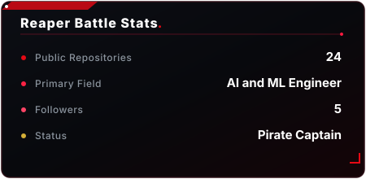
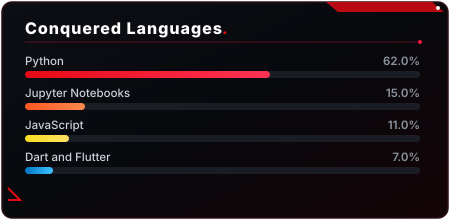

<!-- ================================================================= -->
<!--          THEBILALBUTT // BANKAI × PIRATE DEVELOPER HQ             -->
<!-- ================================================================= -->

<div align="center">

<!-- HERO ANIMATED BANNER -->
<a href="https://github.com/TheBilalButt">
  
</a>

<!-- SECTION DIVIDER -->


<!-- TYPING ANIMATION TERMINAL -->
<a href="https://github.com/TheBilalButt">
  
</a>

<p align="center">
  <a href="https://bilalbutt.tech/"></a>
  <a href="https://github.com/TheBilalButt?tab=repositories"></a>
  <a href="mailto:bilalbutt@duck.com"></a>
</p>

</div>

<br />

<!-- ================================================================= -->
<!--                   🏴‍☠️ SECTION 1: THE CAPTAIN'S LOG                 -->
<!-- ================================================================= -->

<div align="center">
  
</div>

<br />

<table>
  <tr>
    <td width="42%" align="center" valign="middle" style="background-color: #08090d; border: 1px solid #2e1017; border-radius: 8px;">
      
      <br />
      <sub><strong style="color: #ff2244;">⚡ SPIRITUAL PRESSURE // BANKAI MODE</strong></sub>
    </td>
    <td width="58%" valign="top" style="background-color: #08090d; border: 1px solid #2e1017; border-radius: 8px; padding: 16px;">
      <h3 style="color: #ffffff; margin-top: 0;">⚔️ CAPTAIN'S LOG ENTRY</h3>
      <p style="color: #c9d1d9; font-size: 14px; line-height: 1.6;">
        Welcome to my digital fortress. I am <strong>Bilal Butt</strong>, an <strong>AI/ML Engineer</strong> navigating the turbulent waters of Artificial Intelligence and high-performance software engineering from <strong>Pakistan</strong>.
      </p>
      <p style="color: #8b949e; font-size: 13.5px; line-height: 1.6;">
        Much like forging a Zanpakuto through relentless training, I build scalable intelligent systems, computer vision architectures, and autonomous machine learning workflows that turn complex data into decisive action.
      </p>
      <table style="width: 100%; border: none;">
        <tr>
          <td style="border: none; color: #8b949e; font-size: 13px;">🏴‍☠️ <strong>Callsign:</strong> Bilal Butt</td>
          <td style="border: none; color: #8b949e; font-size: 13px;">📍 <strong>Port:</strong> Pakistan</td>
        </tr>
        <tr>
          <td style="border: none; color: #8b949e; font-size: 13px;">🧠 <strong>Specialty:</strong> AI / Deep Learning / CV</td>
          <td style="border: none; color: #8b949e; font-size: 13px;">🗡️ <strong>Philosophy:</strong> Conquering Code</td>
        </tr>
      </table>
      <br />
      <blockquote style="border-left: 3px solid #e50914; color: #ff6b81; margin: 0; padding-left: 10px; font-style: italic; font-size: 12.5px;">
        "We can't fear what we don't understand. We build intelligence to conquer the unknown."
      </blockquote>
    </td>
  </tr>
</table>

<br />

<div align="center">
  
</div>

<br />

<!-- ================================================================= -->
<!--                   ⚔️ SECTION 2: MY ARSENAL                       -->
<!-- ================================================================= -->

<div align="center">
  
</div>

<br />

<div align="center">

### 🗡️ CORE COMBAT LANGUAGES
<p align="center">
  <a href="https://skillicons.dev">
    
  </a>
</p>

```
  PYTHON ✦ C++ ✦ JAVA ✦ DART ✦ JAVASCRIPT ✦ SQL (POSTGRESQL & MYSQL)
```

### 🧠 INTELLIGENCE & COMPUTER VISION MATRIX
<p align="center">
  <a href="https://skillicons.dev">
    
  </a>
</p>

```
  PYTORCH ✦ TENSORFLOW ✦ OPENCV ✦ SCIKIT-LEARN ✦ STREAMLIT ✦ HOG / SIFT ✦ GENETIC ALGORITHMS
```

### ⚓ SYSTEMS, SHIPS & TELEMETRY
<p align="center">
  <a href="https://skillicons.dev">
    
  </a>
</p>

```
  FLUTTER ✦ DOCKER ✦ GIT & GITHUB ✦ LINUX WORKSTATIONS ✦ VS CODE ✦ SYSTEM ARCHITECTURE
```

</div>

<br />

<div align="center">
  
</div>

<br />

<!-- ================================================================= -->
<!--                   💀 SECTION 3: BATTLE RECORD                    -->
<!-- ================================================================= -->

<div align="center">
  
</div>

<br />

<!-- BESPOKE DARK RED METRICS & TOP LANGUAGES CARDS -->
<div align="center">
  <table style="border: none;">
    <tr>
      <td width="50%" align="center" style="border: none;">
        
      </td>
      <td width="50%" align="center" style="border: none;">
        
      </td>
    </tr>
  </table>
</div>

<br />

<!-- GITHUB STREAK & BATTLE ENGAGEMENT -->
<div align="center">
  <a href="https://github.com/TheBilalButt">
    
  </a>
</div>

<br />

<!-- GITHUB ACTIVITY RADAR -->
<div align="center">
  <a href="https://github.com/TheBilalButt">
    
  </a>
</div>

<br />

<div align="center">
  
</div>

<br />

<!-- ================================================================= -->
<!--                   🚢 SECTION 4: MY VOYAGES                       -->
<!-- ================================================================= -->

<div align="center">
  
</div>

<br />

<!-- PROJECT CARDS -->
<table>
  <tr>
    <td width="50%" valign="top" style="background-color: #08090d; border: 1px solid #2e1017; border-radius: 8px; padding: 14px;">
      <h3 style="margin-top: 0; color: #ff2a4b;">
        🧵 <a href="https://github.com/TheBilalButt/TexEye-AI-FYP" style="color: #ff4d66; text-decoration: none;">TexEye AI: Defect Detection & Quality Management</a>
      </h3>
      <p style="color: #c9d1d9; font-size: 13.5px; line-height: 1.5;">
        AI-powered industrial fabric defect detection and automated quality control framework. BS-AI Final Year Project featuring rigorous architectural design, defect classification pipelines, and full UML specifications.
      </p>
      <p style="font-size: 12px; color: #8b949e;">
        <strong>Weaponry:</strong> <code>Computer Vision</code> <code>AI Inspection</code> <code>System Architecture</code> <code>Mermaid</code>
      </p>
      <a href="https://github.com/TheBilalButt/TexEye-AI-FYP">
        
      </a>
    </td>
    <td width="50%" valign="top" style="background-color: #08090d; border: 1px solid #2e1017; border-radius: 8px; padding: 14px;">
      <h3 style="margin-top: 0; color: #ff2a4b;">
        🧠 <a href="https://github.com/TheBilalButt/psychological-state-analysis-multimodal-ai" style="color: #ff4d66; text-decoration: none;">Multimodal AI: Psychological State Analysis</a>
      </h3>
      <p style="color: #c9d1d9; font-size: 13.5px; line-height: 1.5;">
        State-of-the-art multimodal AI research application evaluating psychological markers across vision, voice, and linguistic streams. Packaged with a sleek macOS & Linear styled research dashboard live on Streamlit.
      </p>
      <p style="font-size: 12px; color: #8b949e;">
        <strong>Weaponry:</strong> <code>Python</code> <code>Multimodal AI</code> <code>Streamlit</code> <code>Facial & NLP Analytics</code>
      </p>
      <a href="https://github.com/TheBilalButt/psychological-state-analysis-multimodal-ai">
        
      </a>
    </td>
  </tr>
  <tr>
    <td width="50%" valign="top" style="background-color: #08090d; border: 1px solid #2e1017; border-radius: 8px; padding: 14px;">
      <h3 style="margin-top: 0; color: #ff2a4b;">
        🛡️ <a href="https://github.com/TheBilalButt/AMOPS" style="color: #ff4d66; text-decoration: none;">AMOPS: Defense Operations & Fleet Management</a>
      </h3>
      <p style="color: #c9d1d9; font-size: 13.5px; line-height: 1.5;">
        Cross-platform defense operations suite and tactical fleet coordination system built in Flutter. Delivers mission asset tracking, multi-unit telemetry, and secure operational logistics control.
      </p>
      <p style="font-size: 12px; color: #8b949e;">
        <strong>Weaponry:</strong> <code>Flutter</code> <code>Dart</code> <code>Fleet Telemetry</code> <code>Cross-Platform</code>
      </p>
      <a href="https://github.com/TheBilalButt/AMOPS">
        
      </a>
    </td>
    <td width="50%" valign="top" style="background-color: #08090d; border: 1px solid #2e1017; border-radius: 8px; padding: 14px;">
      <h3 style="margin-top: 0; color: #ff2a4b;">
        👁️ <a href="https://github.com/TheBilalButt/realtime-cv-filter-studio" style="color: #ff4d66; text-decoration: none;">Real-time Computer Vision Filter Studio</a>
      </h3>
      <p style="color: #c9d1d9; font-size: 13.5px; line-height: 1.5;">
        Interactive Computer Vision development laboratory for real-time video stream filtering, spatial convolution analysis, edge detection operators, and frequency-domain visual inspection.
      </p>
      <p style="font-size: 12px; color: #8b949e;">
        <strong>Weaponry:</strong> <code>Python</code> <code>OpenCV</code> <code>Spatial Filtering</code> <code>Real-Time CV</code>
      </p>
      <a href="https://github.com/TheBilalButt/realtime-cv-filter-studio">
        
      </a>
    </td>
  </tr>
  <tr>
    <td width="50%" valign="top" style="background-color: #08090d; border: 1px solid #2e1017; border-radius: 8px; padding: 14px;">
      <h3 style="margin-top: 0; color: #ff2a4b;">
        🧟 <a href="https://github.com/TheBilalButt/zombie-outbreak-simulator" style="color: #ff4d66; text-decoration: none;">Zombie Outbreak Simulator (Agent-Based Model)</a>
      </h3>
      <p style="color: #c9d1d9; font-size: 13.5px; line-height: 1.5;">
        Real-time interactive Agent-Based Modeling (ABM) web platform simulating epidemiological transmission dynamics, contagion thresholds, and emergent survivor-horde interactions.
      </p>
      <p style="font-size: 12px; color: #8b949e;">
        <strong>Weaponry:</strong> <code>JavaScript</code> <code>Agent-Based Modeling</code> <code>Spatial Dynamics</code> <code>HTML5</code>
      </p>
      <a href="https://github.com/TheBilalButt/zombie-outbreak-simulator">
        
      </a>
    </td>
    <td width="50%" valign="top" style="background-color: #08090d; border: 1px solid #2e1017; border-radius: 8px; padding: 14px;">
      <h3 style="margin-top: 0; color: #ff2a4b;">
        🧬 <a href="https://github.com/TheBilalButt/lab-07-ga-hog-medical-classification" style="color: #ff4d66; text-decoration: none;">GA + HOG Medical Image Classification</a>
      </h3>
      <p style="color: #c9d1d9; font-size: 13.5px; line-height: 1.5;">
        Medical machine learning research applying Evolutionary Genetic Algorithms to optimize Histogram of Oriented Gradients (HOG) feature descriptors for PneumoniaMNIST diagnosis.
      </p>
      <p style="font-size: 12px; color: #8b949e;">
        <strong>Weaponry:</strong> <code>Python</code> <code>Genetic Algorithms</code> <code>HOG / SIFT</code> <code>Scikit-Learn</code>
      </p>
      <a href="https://github.com/TheBilalButt/lab-07-ga-hog-medical-classification">
        
      </a>
    </td>
  </tr>
</table>

<br />

<div align="center">
  
</div>

<br />

<!-- ================================================================= -->
<!--                   ☠️ SECTION 5: THE CREW & ALLIANCES              -->
<!-- ================================================================= -->

<div align="center">
  
</div>

<br />

<div align="center">

<p style="color: #c9d1d9; font-size: 14.5px;">
  Ready to join forces on revolutionary AI/ML ventures, open-source conquests, or system architecture?
</p>

<p align="center">
  <a href="https://bilalbutt.tech/">
    
  </a>
  <a href="https://github.com/TheBilalButt">
    
  </a>
  <a href="mailto:bilalbutt@duck.com">
    
  </a>
</p>

<br />

<!-- ANIME FOOTER QUOTE & INSIGNIA -->
<table style="border: none; max-width: 750px;">
  <tr>
    <td align="center" style="border: none;">
      
      <br /><br />
      <p style="color: #8b949e; font-style: italic; font-size: 13.5px; line-height: 1.6; margin: 0;">
        "If you don't take risks, you can't create a future. Conquering code requires the courage of a pirate and the resolve of a Soul Reaper."
      </p>
      <sub style="color: #e50914; font-weight: 700; letter-spacing: 2px;">— THE CAPTAIN'S CODE // 卍解 // ONE PIECE</sub>
    </td>
  </tr>
</table>

<br />

<!-- FOOTER KATANA SLASH -->


<p align="center" style="color: #484f58; font-size: 11px; letter-spacing: 2px;">
  © 2026 THEBILALBUTT ✦ ARCHITECTED WITH BANKAI PRECISION & GRAND LINE RESOLVE
</p>

</div>
